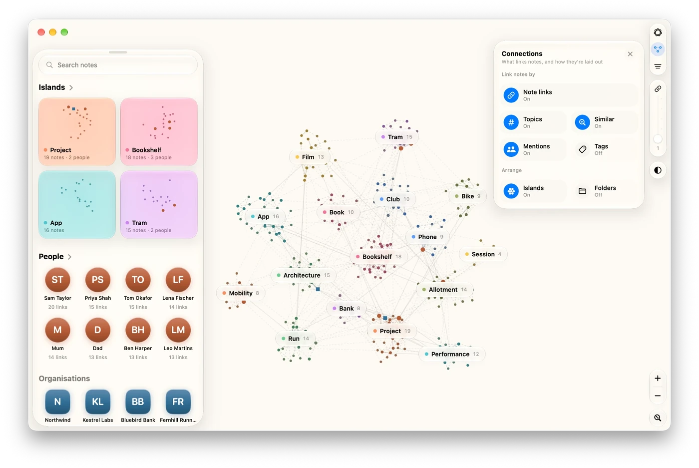
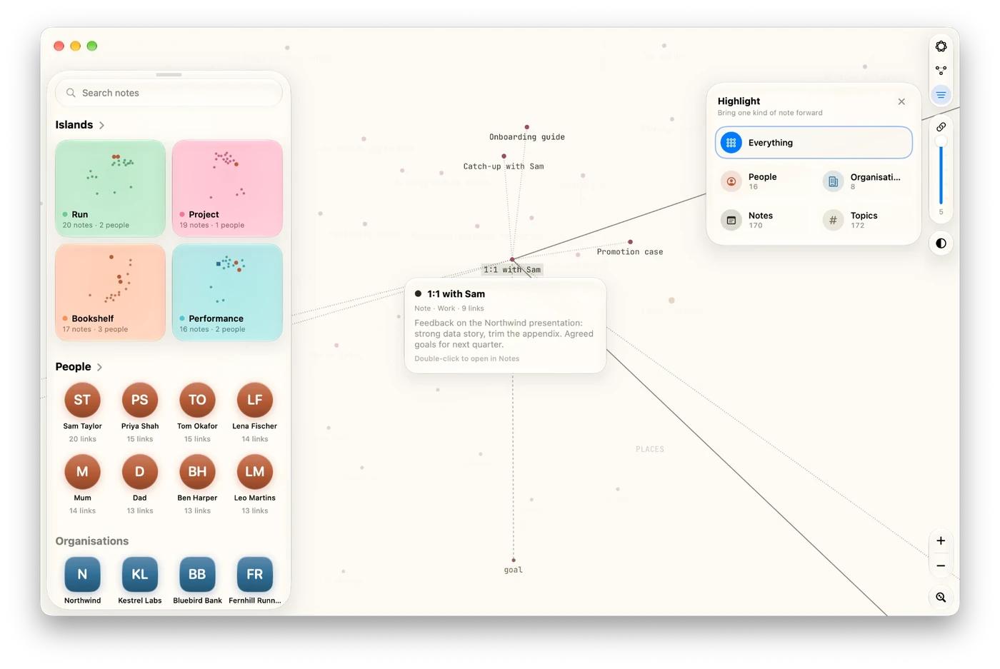
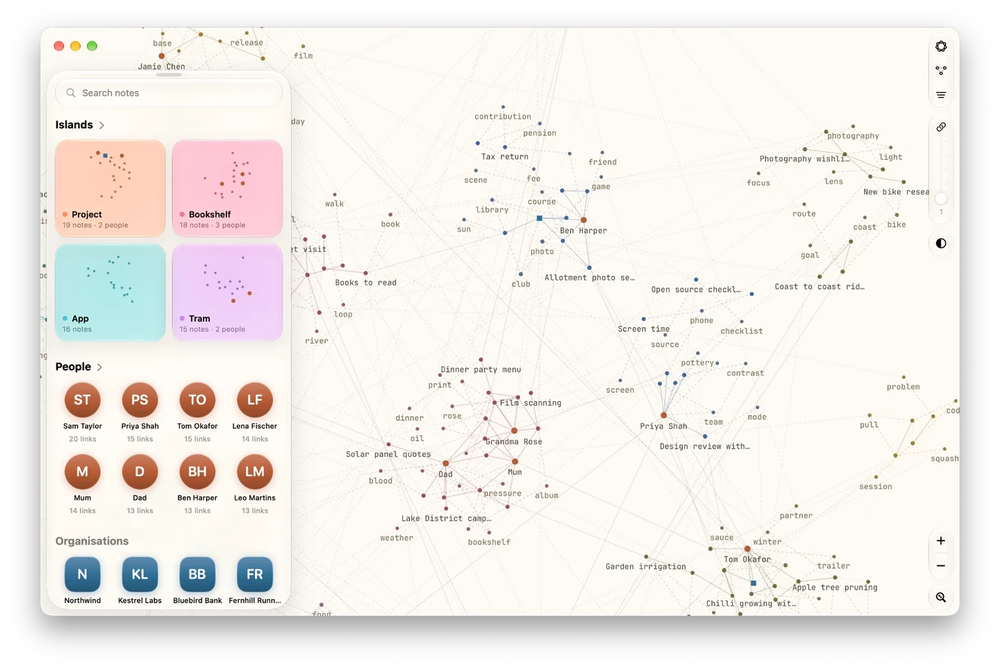
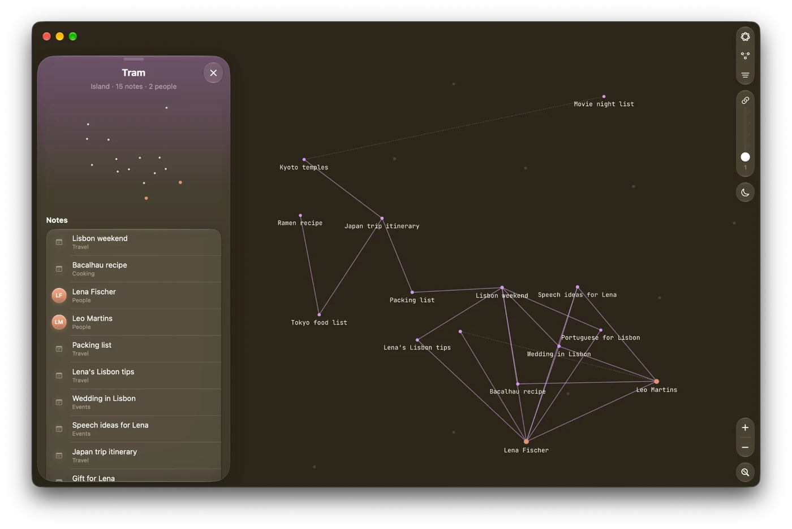
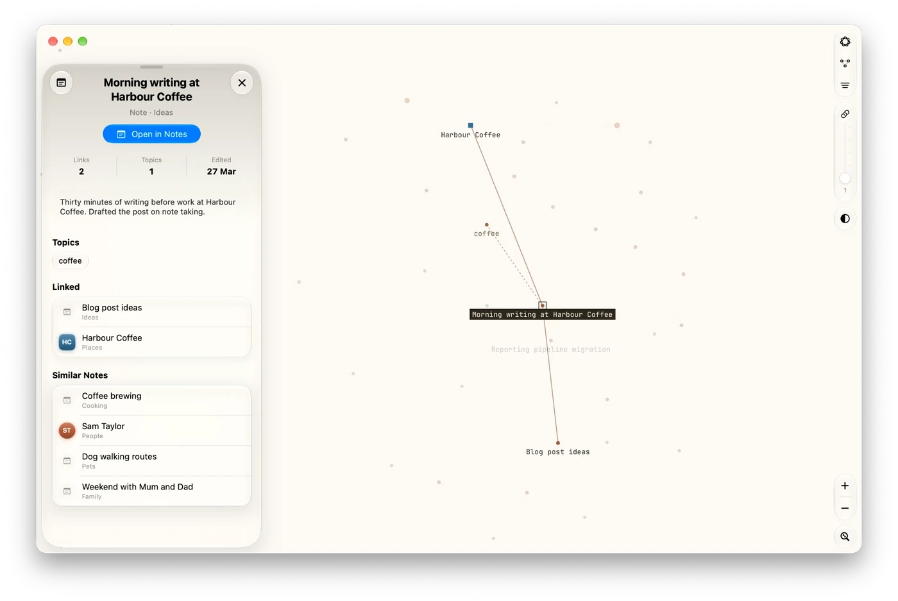
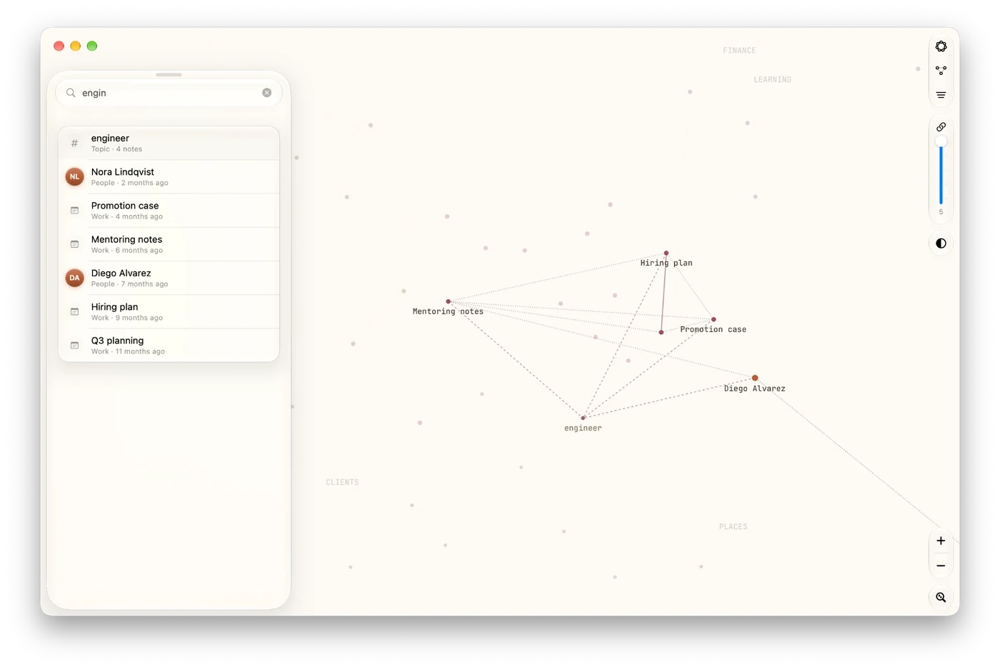

import icon from "./_media/notes-mesh/icon.png";

You can visualize your Apple Notes with [Notes Mesh](https://github.com/jonothanhunt/notesmesh), a free and open source Mac app I made.

https://www.tiktok.com/@jonothan.dev/video/7711441608524451075

It works in two ways:

One: basic keyword tagging, which works pretty well.

Or even better, two: Apple Intelligence models right on your device tag the notes in the app a bit more smartly.

You can change how notes cluster in the graph, and what labels it shows, like people and topics.

And it has light and dark modes.

The graph I'm showing here is an example one. If you have a big collection of notes, you might, like me, find it really interesting to see how they cluster, and find themes you might not otherwise have picked up.

The whole thing is written as a native app using Swift and Metal. It's kind of developed over time from a personal app I've been using for ages. I created the UI and UX, and agents predominantly coded the logic.

It's read-only. There's no network or cloud or analytics or anything, and it's open source.

If you like it and want to contribute, please do. Search [Notes Mesh on GitHub](https://github.com/jonothanhunt/notesmesh).
